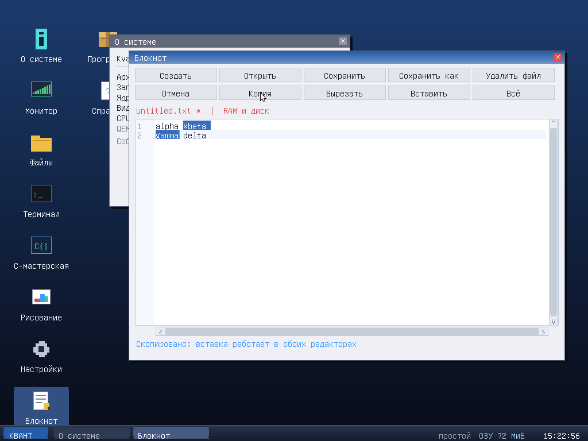
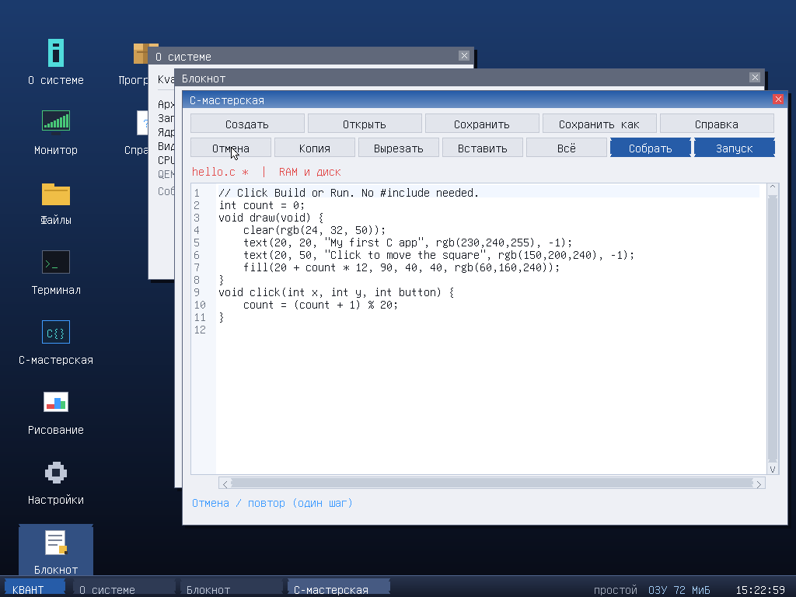
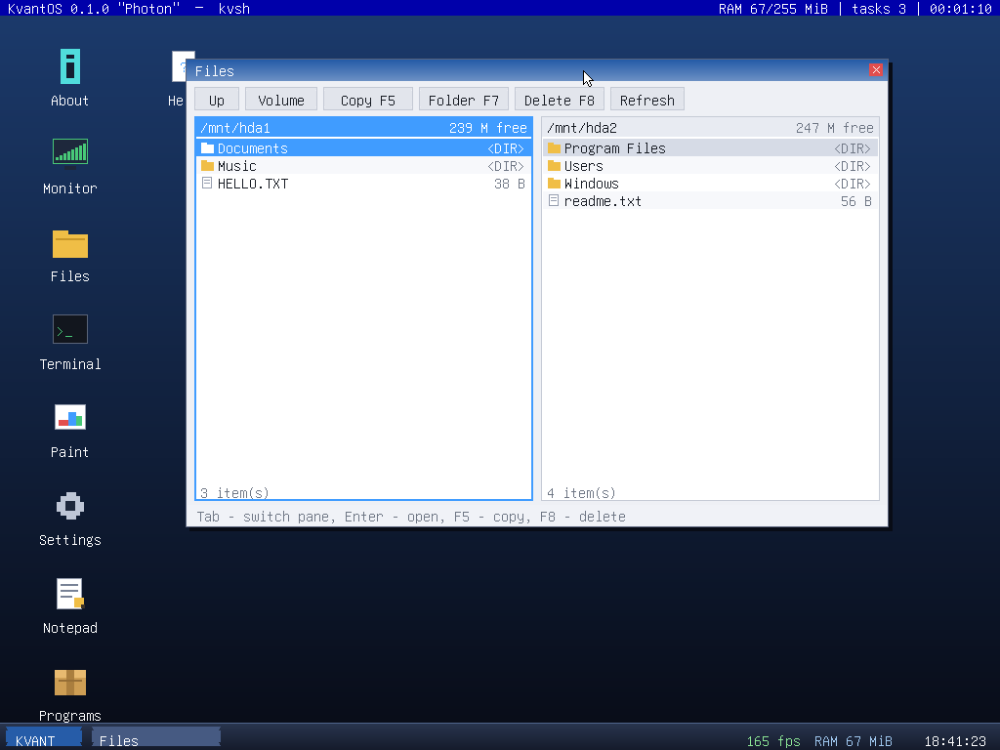
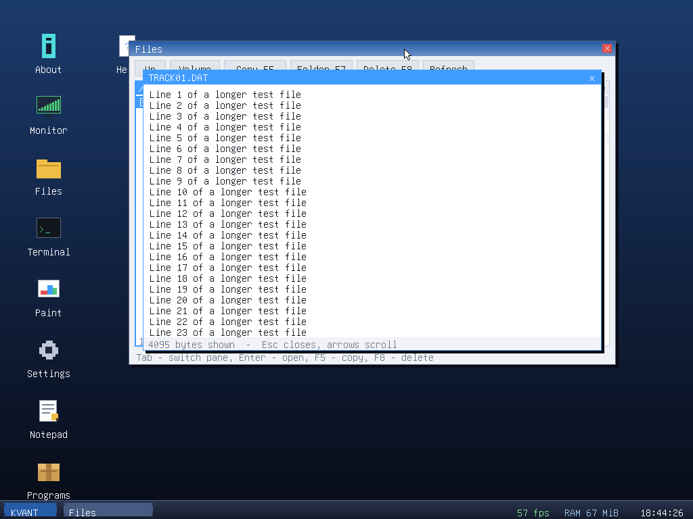
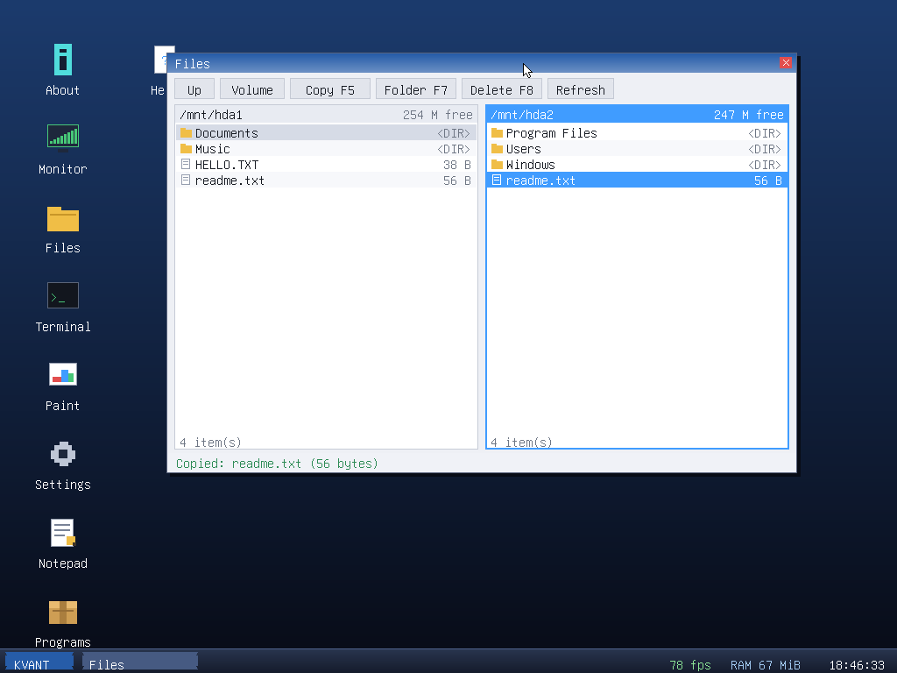
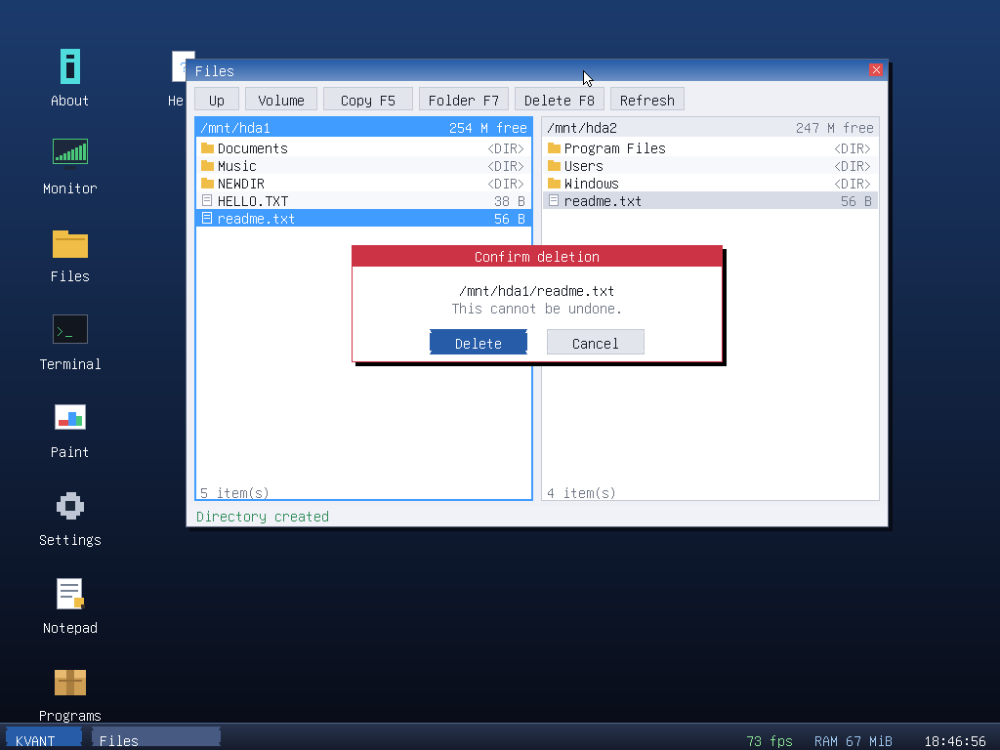
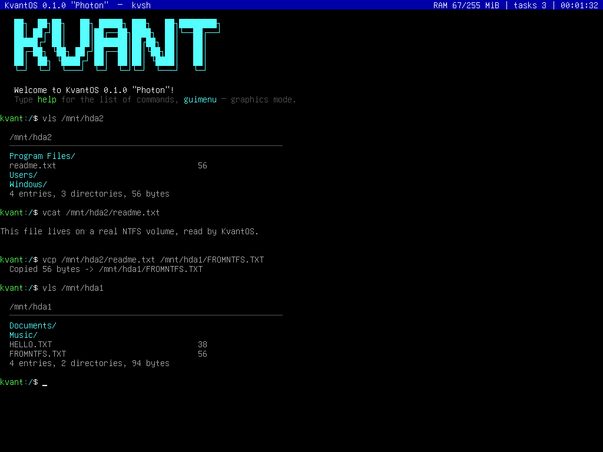
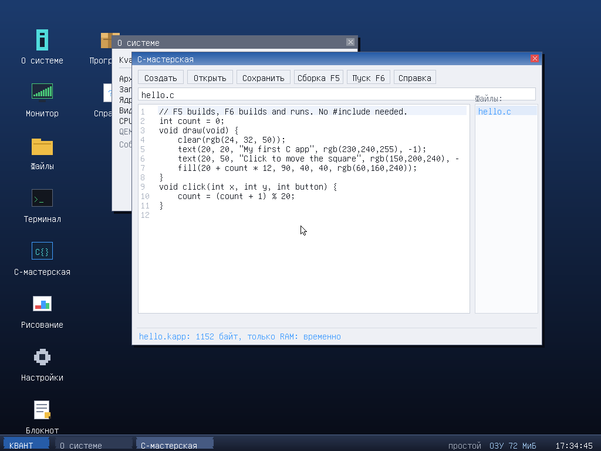
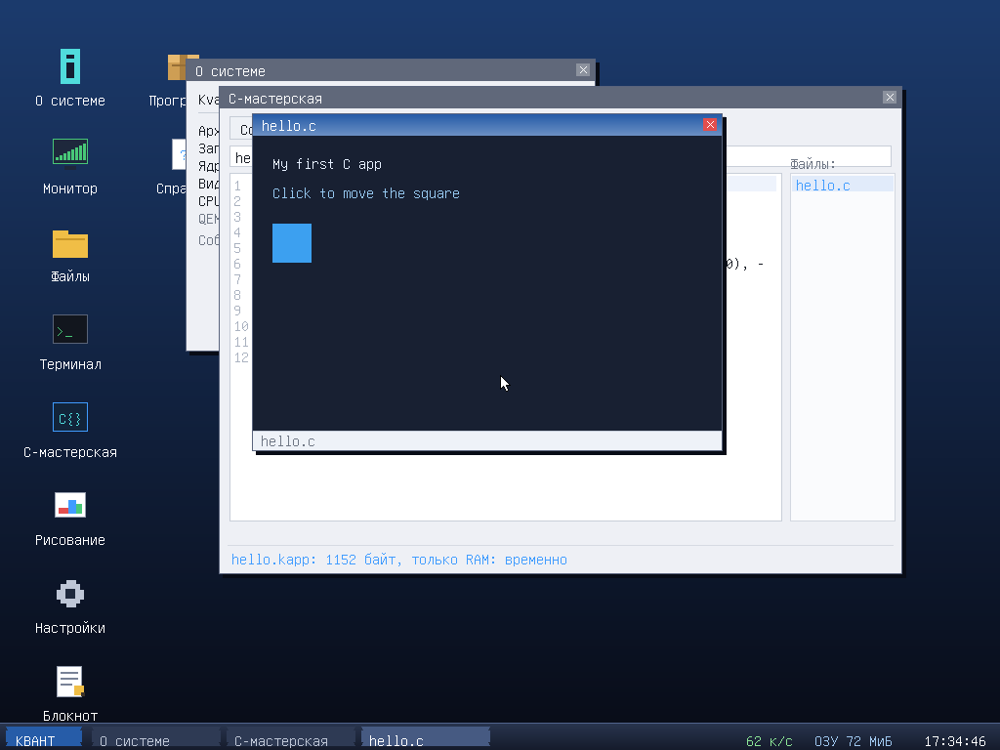

# KvantOS 3.5.0

**Новое в 3.5.0:** read-only `/proc` и экспериментальные shared ARGB-буферы
CPL3-приложений. Размер пока 420×300; resize, dirty rectangles и динамические
модули ядра не реализованы. Подробнее — [заметки релиза](RELEASE.ru.md).


Исходники и инструкции к релизу 3.5.0: [заметки релиза](RELEASE.ru.md), [список изменений](CHANGELOG.md), [план работ](ROADMAP.md).

**Новое в 3.4.0:** светлый интерфейс «Бриз» в духе Windows 7.
[Описание и превью](docs/BREEZE.ru.md); образы 3.3.0 сохраняют прежнюю тему, для «Бриза» нужны образы 3.4.0.

*Английская версия: [README.md](README.md).*

Полностью самописная **операционная система для x86** с двумя ядрами:
классическая **32-битная** сборка (`kvant.bin`, загрузка через **GRUB 2**
по Multiboot 1) и, начиная с версии 3.0, **64-битная** сборка
(`kvant64.bin`), которую загружает собственный **UEFI-загрузчик на C**
(`BOOTX64.EFI`) — без GRUB, без legacy MBR и без CSM: единственный путь
на современное железо. Никакой стандартной библиотеки C — только
freestanding-заголовки компилятора.

**Ограничение 64-битной версии:** менеджер физических страниц и драйвер
фреймбуфера пока используют 32-битные физические адреса. Ядро использует
не более первых 4 ГиБ адресного пространства; если GOP-фреймбуфер расположен
выше 4 ГиБ, система отклоняет его и переходит в текстовый режим.

```
   ██╗  ██╗██╗   ██╗ █████╗ ███╗   ██╗████████╗
   ██║ ██╔╝██║   ██║██╔══██╗████╗  ██║╚══██╔══╝
   █████╔╝ ██║   ██║███████║██╔██╗ ██║   ██║
   ██╔═██╗ ╚██╗ ██╔╝██╔══██║██║╚██╗██║   ██║
   ██║  ██╗ ╚████╔╝ ██║  ██║██║ ╚████║   ██║
   ╚═╝  ╚═╝  ╚═══╝  ╚═╝  ╚═╝╚═╝  ╚═══╝   ╚═╝
```

## C-мастерская — создание приложений прямо в ОС

**Значок «C-мастерская»** или меню **КВАНТ → C-мастерская** открывает `hello.c`.
Кнопка **«Собрать»** создаёт нативный `.kapp`, **«Запуск»** пересобирает и запускает.
Работает и в **32-битной BIOS**, и в **64-битной UEFI** сборке; GCC и сеть
в гостевой ОС не нужны. Это ограниченное подмножество C, не полный GCC.
**«Сохранить»** записывает исходник, **«Открыть»** показывает список файлов RAM/диска;
с KvFS файлы переживают перезапуск,
без диска сохраняются только в RAM. Документ независим от блокнота.

[Руководство C-мастерской](sdk/WORKSHOP.ru.md) · [Релиз 3.5.0](RELEASE.ru.md)

## Импорт FAT32 / USB и политика записи (без изменений в 3.5.0)

В версии 3.1.3 в Блокноте и C-мастерской появилась кнопка **Импорт**:
выбор FAT-тома, папок и файла мышью, отдельное локальное имя, безопасная копия
в RAM и дальнейшее сохранение на KvFS. Источник не изменяется.
USB mass-storage включает UHCI, EHCI с OHCI-компаньонами и отдельный full-speed
OHCI backend. xHCI/USB 3 и UAS не поддерживаются; hub/TT routing ограничен и
экспериментален. Физические носители и VirtualBox программной матрицей не
квалифицированы.
**Жёсткий лимит 128 строк снят**: дальше только янтарное предупреждение,
импорт, редактирование и сохранение не блокируются. Отдельного лимита строк
нет; текст меньше 64 КиБ, строка до 120 байт. У компилятора отдельно остаётся
16000 байт исходника. См. [мастерскую](sdk/WORKSHOP.ru.md).

Теперь поддерживается и **GPT + FAT32**, включая служебный MSR перед
разделом данных, проверку CRC и резервную таблицу. Чтение без преобразования
разметки и без форматирования. [Инструкция и ограничения](USB-IMPORT.ru.md).

Обычные FAT-тома монтируются RO. Запись возможна только на заранее подготовленный
FAT32 с owned-file журналом `KVANTWAL.SYS`, после проверки recovery и явного
включения на текущий сеанс `fatwrite ИМЯ_ТОМА enable`. Ядро не создаёт и не
сбрасывает журнал; неподготовленный или повреждённый том остаётся RO либо
скрывается. См. [политику хранения](docs/STORAGE-M2.md).

## Быстрый старт

```bash
make          # собрать 32- и 64-битные ядра и UEFI-загрузчик
make iso      # собрать гибридный BIOS + UEFI образ build/kvantos.iso
make run      # запустить BIOS/32-битный путь в QEMU (лог идёт в COM1/stdout)
```

Для локальной проверки используйте QEMU и команды ниже. Физические флешки,
SATA-устройства и VirtualBox не квалифицированы; не записывайте образ на
единственный или незарезервированный носитель.

### Тесты

```bash
make -C tests/fs image && make -C tests/fs check   # FAT/NTFS-драйверы; нужны системные утилиты и sudo
make release                                        # подготовить ISO для smoke-теста
tests/boot/qemu-smoke.sh release/kvantos.iso        # BIOS + UEFI, ожидание приглашения оболочки
```

Smoke-тест требует QEMU и OVMF; подробности — в [tests/boot/README.md](tests/boot/README.md).

## Язык интерфейса

По умолчанию система говорит **по-английски** и умеет переключаться на
**русский прямо во время работы** — весь интерфейс, оболочка, графическая
среда и приложения.

| Как | Что сделать |
|---|---|
| Меню GRUB | выбрать второй пункт, *KvantOS - Russian interface* |
| Командная строка ядра | добавить `lang=ru` |
| Внутри системы | набрать `lang ru` (обратно — `lang en`) |

Механизм — один макрос `T(en, ru)` из `include/i18n.h`: он выбирает строку
из пары во время работы, поэтому оба языка живут в одном двоичном файле и
переключение ничего не стоит. Приложения получают тот же переключатель
через ABI — `sys->lang()` или макрос `KV_T(sys, en, ru)`. Все комментарии
в исходниках, сборочные скрипты и документы репозитория — на английском;
русские версии документов лежат рядом как `*.ru.md`.

## Что реализовано

### Загрузка
* Multiboot 1 заголовок, точка входа на ассемблере (`boot/boot.asm`)
* Разбор структуры multiboot: карта памяти (`mmap`), имя загрузчика, объём ОЗУ
* Меню GRUB на русском языке с несколькими пунктами

### Ядро
| Подсистема | Детали |
|---|---|
| **GDT** | 5 дескрипторов: код/данные ring 0 и ring 3, плюс TSS для будущего userspace |
| **IDT** | 32 обработчика исключений, 16 IRQ, вектор `0x80` под системные вызовы |
| **PIC 8259** | Ремаппинг IRQ на векторы 32–47, корректная отправка EOI |
| **PIT** | Системный таймер 500 Гц (квант планировщика 2 мс), источник вытеснения задач |
| **PMM** | Битовая карта физических страниц 4 КиБ на основе multiboot mmap |
| **Paging** | Identity-mapping первых 16 МиБ, `CR3`/`CR0.PG`, обработчик `#PF` с дампом `CR2` |
| **Куча** | 10 МиБ, `kmalloc`/`kfree`/`kcalloc`, first-fit, разбиение и слияние соседних блоков, magic-числа против порчи |
| **Планировщик** | Round-robin с вытеснением по IRQ0, переключение контекста на ассемблере, состояния готова/спит/завершена, автоматическая уборка мёртвых задач |
| **ramfs** | Плоская ФС в ОЗУ: создание, чтение, удаление файлов |

### Графический режим — команда `guimenu`

Полноценная оконная среда **KvantGUI** поверх линейного фреймбуфера VBE,
который запрашивается у GRUB через видеополя Multiboot-заголовка (1024×768×32).

* **Рабочий стол** — градиентный фон, 9 иконок с нарисованной пиксельной графикой
* **Окна** — заголовок с градиентом, тень, кнопка закрытия, перетаскивание мышью,
  z-порядок (клик поднимает окно наверх)
* **Панель задач** — кнопки открытых окон, часы из RTC, счётчик памяти
* **Мышь PS/2** — драйвер на IRQ12, аппаратный курсор рисуется программно,
  поддержка клика, перетаскивания и двойного клика
* **Двойная буферизация с dirty rectangles** — изменённые области объединяются,
  восстанавливаются из кэша обоев и иконок, а перерисовываются только пересекающиеся
  окна. Движение курсора обновляет старую и новую области; фон не рендерится снова
  на каждом кадре игры. ABI 3 добавляет `delta_ms()` для симуляции, не зависящей
  от FPS; ABI 2 остаётся совместимым. `L` меняет предел вывода 60/30 к/с или отключает его.
* **Мини-приложения**: «О системе», «Монитор» (память, куча, задачи в реальном
  времени), «Файлы» (ramfs), «Терминал» (help/mem/ps/ls/date/uptime/about/clear),
  «Рисование» (холст 44×26 с палитрой), «Настройки», «Справка»

#### Приложение «Настройки»

Графический аналог команд `vidmode`/`refresh` — три вкладки:

* **Экран** — сетка доступных разрешений (режимы, не влезающие в видеопамять,
  скрыты), выбор частоты обновления, кнопка «Применить». Разрешение меняется
  **прямо во время работы среды**: буфер под новый шаг строки выделяется *до*
  обращения к видеокарте, окна подтягиваются в границы экрана, курсор
  перецентрируется. Если буфер выделить не удалось, режим не меняется вовсе —
  рабочий стол никогда не остаётся без заднего буфера, иначе на реальном железе
  рисование пошло бы напрямую в некэшируемую видеопамять и выглядело бы как
  зависание. После успешной смены появляется баннер с подтверждением:
  **Enter** оставляет новый режим, **Esc** отменяет, а если 15 секунд нет
  ввода — прежнее разрешение возвращается автоматически, поэтому неподходящий
  режим не может заблокировать доступ к системе
  (`screenshots/56_revert_banner.png`, `57_auto_reverted.png`).
* **Оформление** — 6 цветов акцента (перекрашивают заголовки окон, кнопку
  «Пуск» и фон), 4 стиля обоев (градиент, ночь, сетка, однотонный),
  флажки теней под окнами и секунд в часах.
* **Система** — версия, процессор, память, куча, время работы, число задач
  и устройств PCI, выход в консоль.

Внутри реализована система *hit-областей*: при перерисовке сцены виджеты
регистрируют свои прямоугольники, а клик мышью ищет попадание в обратном порядке отрисовки.

Управление мышью: один щелчок по значку или **КВАНТ → приложение** открывает окно,
нижняя панель переключает окна, заголовок перетаскивается, крестик закрывает.
Выход — **КВАНТ → Выйти в консоль**. Одиночные G/B/E/T/Q/W и другие буквы
больше не запускают и не закрывают окна. Клавиши внутри игр не изменены.

В Блокноте и C-мастерской: щелчок ставит курсор, протяжка выделяет текст,
кнопки **Копия / Вырезать / Вставить / Отмена / Повтор / Всё** работают без сочетаний
клавиш. Буфер обмена общий, документы и многошаговая история независимы. Кнопки «Отмена» и «Повтор»
раздельные; до 64 правок в пределах 128 КиБ текста истории на редактор (плюс служебные записи). Крупные
замены могут вытеснять старые правки раньше. Отмена/повтор к точке сохранения
корректно снимают признак несохранённого текста.
Колесо и перетаскиваемые вертикальная/горизонтальная полосы прокручивают текст,
не сдвигая курсор; протяжка за край области продолжает выделение с прокруткой.
**Сохранить как** и **Открыть** имеют файловый список, поле имени и кнопки.
При создании, открытии, закрытии и выходе предлагается сохранить несохранённый
текст; замена другого файла и удаление требуют подтверждения. Блокнот, как и
мастерская, сохраняет в RAM и на смонтированный KvFS. Без диска RAM временна.
Клавиатура остаётся для текста, стрелок и необязательных Ctrl+C/V/X/A/Z/Y/S,
Ctrl+O/N/W, F5/F6. Esc отменяет диалог/выделение, а не закрывает редактор.

Без физической мыши можно включить **КВАНТ → Мышь с NumPad** либо NumLock:
8/2/4/6 и 7/9/1/3 двигают курсор, 5 щёлкает, 0 зажимает кнопку, точка отпускает;
Shift даёт точный шаг, Ctrl ускоряет, +/- меняют скорость. По умолчанию выключено.




### Видеокарта, разрешение и частота

Ядро само управляет видеоадаптером, без обращения к BIOS: из защищённого
режима `int 0x10` недоступен, поэтому регистры программируются напрямую.

| Команда | Назначение |
|---|---|
| `lspci` / `lspci -v` | перечисление устройств PCI, классы, BAR, IRQ |
| `gpu` | модель видеокарты, объём видеопамяти, драйвер, текущий режим |
| `vidmode` | таблица из 12 режимов с проверкой, влезают ли они в видеопамять |
| `vidmode 6` | переключиться на режим №6 из таблицы |
| `vidmode 1280 720 32` | произвольное разрешение и глубина цвета |
| `refresh` | текущая частота: расчёт по CRTC и замер по сигналу VSync |
| `refresh 75` | задать частоту кадров |

**Как это устроено.** Шина PCI перебирается через порты `0xCF8`/`0xCFC`
(256 шин × 32 слота, с учётом многофункциональных устройств); объём
видеопамяти определяется записью маски в BAR. Смена разрешения выполняется
через **Bochs VBE Extensions** (порты `0x1CE`/`0x1CF`) — их понимают QEMU,
Bochs и VirtualBox; для VMware реализован путь через регистры SVGA II в BAR0.
После переключения драйвер заново отображает видеопамять в адресное
пространство, пересчитывает формат пикселя (BGRX для 32/24 бит, RGB565 для 16)
и перестраивает сетку консоли — например, 1280×1024 даёт 160×64 символа.
Графическая среда `guimenu` подхватывает новое разрешение автоматически.

**Частота кадров** меняется перепрограммированием вертикальных таймингов CRTC:
пересчитываются Vertical Total, Retrace Start и Retrace End сразу, единым
блоком. Менять только Vertical Total нельзя — импульс синхронизации остался бы
на прежнем месте, сигнал стал бы некорректным и монитор погасил бы картинку
(этот баг был пойман на скриншотах и исправлен). В режиме линейного буфера
развёрткой управляет хост, поэтому система честно сообщает об этом вместо
того, чтобы показывать выдуманное число.

### Драйверы
* **Консоль** — работает в двух режимах: классический VGA 80×25 через 0xB8000
  со своим шрифтом в плоскости 2, либо программная отрисовка глифов прямо
  в фреймбуфер (128×48 символов при 1024×768). Переключается автоматически
* **Фреймбуфер VBE** — 32/24/16 бит на пиксель, заливки, градиенты,
  скруглённые прямоугольники, текст, аппаратная прокрутка области
* **Мышь PS/2** — IRQ12, 3-байтные пакеты, контроль синхробита и переполнения
* **Кириллица** — шрифт в раскладке CP866 генерируется из системных PSF
  (`tools/mkfont.py`), драйвер на лету декодирует UTF-8 → CP866
* **PS/2 клавиатура** — набор скан-кодов 1, Shift/Ctrl/CapsLock, стрелки,
  кольцевой буфер, обработка в прерывании
* **RTC/CMOS** — чтение даты и времени, поддержка BCD и 12/24-часового формата
* **COM1** — дублирование всего вывода ядра в последовательный порт для отладки
* **PC-Speaker** — генерация звука через канал 2 PIT

### Файловые системы и тома
KvantOS читает таблицу разделов каждого диска ATA, распознаёт найденные
файловые системы и подключает их в единое пространство имён под `/mnt`.

| Файловая система | Чтение | Запись | Примечания |
|---|---|---|---|
| **FAT32** | да | только подготовленный том + opt-in | VFAT, подкаталоги; M2.4: owned WAL, по умолчанию RO |
| **FAT16** | да | нет в обычном ISO | алгоритм записи тестируется отдельно; production пока RO |
| **NTFS** | да | **нет** | MFT, резидентные и нерезидентные данные, B-деревья |
| KvFS | да | да | собственный формат системы, для установленных приложений |
| ramfs | да | да | файлы в ОЗУ, из модулей загрузчика |

**FAT32/FAT16** — общий драйвер; чтение доступно на обычных томах, запись в
обычном ISO — только на подготовленном FAT32 после явного opt-in. Он читает
и (при разрешённой записи) создаёт длинные имена в
UTF-16, ходит по подкаталогам, выделяет и освобождает кластеры сразу в обеих
копиях FAT, поддерживает в актуальном состоянии счётчик свободных кластеров в
FSInfo и создаёт каталоги с записями `.` и `..`. Одноразовые образы проверяются
независимым `fsck.fat`; перед записью/ремонтом другой ОС незавершённый WAL
необходимо восстановить в KvantOS (см. M2.4 ниже). Аппаратной проверки Windows нет.

**NTFS намеренно только для чтения.** Драйвер понимает Master File Table,
поправки update sequence, резидентные и нерезидентные атрибуты `$DATA`,
runlist'ы (включая разрежённые участки), `$ATTRIBUTE_LIST` для сильно
фрагментированных файлов и B-деревья каталогов из `$INDEX_ROOT` и
`$INDEX_ALLOCATION`. Записи нет, и это осознанное решение, а не недоделка: NTFS
журналирует каждое изменение через `$LogFile`, и драйвер, который правил бы том
без ведения журнала, битовой карты кластеров и балансировки B-дерева, оставил бы
файловую систему, которую Windows откажется монтировать. Сжатые и зашифрованные
потоки возвращают ошибку, а не мусор вместо данных.

Не поддерживаются: exFAT (другой формат, у которого лишь совпадает тип раздела с
NTFS — он распознаётся и пропускается) и копирование каталогов целиком одним
действием.

### Файловый менеджер
Двухпанельный менеджер в духе Norton Commander, иконка `Files` на рабочем столе.
Левая панель — источник, правая — приёмник, поэтому копирование всегда идёт
«из активной панели в соседнюю» — в том числе с NTFS на FAT32.

* `Tab` — сменить панель, `Enter` — войти в каталог или посмотреть файл
* `Backspace` — на уровень вверх; в корне тома переходит к следующему тому
* `F5` — копировать, `F7` — новый каталог, `F8` — удалить (с подтверждением),
  `F2` — обновить, `F3` — просмотр
* просмотрщик показывает текст как текст, а двоичные файлы — шестнадцатеричным
  дампом
* тома только для чтения помечены, и любая запись на них отклоняется с
  объяснением, а не молча

### Оболочка kvsh
Интерактивная командная строка с историей (стрелки ↑↓), Ctrl+L, Ctrl+C.

```
help      about     clear     echo      mem       cpu
uptime    date      ps        spawn     kill      ls
cat       write     rm        touch     cp        mv
wc        grep      hexdump   sum       colors    color
beep      alloc     lang      history   crash     reboot
poweroff  guimenu   gfx       lspci     gpu       vidmode
refresh   setup     disk      format    df        dls
dcat      install   uninstall apps      hwreport  mount
rescan    vls       vcd       vcat      vcp       vrm
vmkdir    uname     sysinfo   hostname  whoami    cal
calc      hex       bin       dec       rand      seq
rev       matrix    fortune   melody    countdown ascii
leds      sleep
```

`mount` показывает подключённые тома с типом, меткой и свободным местом,
`vls`/`vcat`/`vcp`/`vrm`/`vmkdir` работают с любым томом по пути
(например, `vcp /mnt/hda2/readme.txt /mnt/hda1/`), а `rescan` заново ищет тома
после смены диска.

`guimenu` — запуск графической среды, `gfx` — сведения о видеорежиме.

Набор утилит: `kill` завершает задачу из списка `ps`; `uname`/`sysinfo`
показывают сводку о системе; `cal` печатает календарь месяца и выделяет
сегодняшний день; `calc` считает целочисленные выражения со скобками;
`hex`/`bin`/`dec` переводят числа между системами счисления; `rand` и `seq`
выдают числа; `wc`/`grep`/`hexdump`/`sum`/`touch`/`cp`/`mv` работают
с файлами в ramfs; `matrix` показывает цифровой дождь; `fortune` печатает
цитату; `melody` и `countdown` используют PC-спикер; `leds dance` устраивает
световое шоу на индикаторах клавиатуры; `color` меняет цвет текста оболочки.

Живая строка состояния сверху обновляется отдельной фоновой задачей
и показывает использование ОЗУ, число задач и время работы системы.

## Структура проекта

```
kvantos/
├── boot/
│   ├── boot.asm        точка входа, Multiboot, GDT/IDT/paging/переключение контекста
│   └── isr.asm         48 заглушек прерываний + общий диспетчер
├── include/kernel.h    единый заголовок ядра
├── kernel/
│   ├── main.c          инициализация подсистем
│   ├── gdt.c  idt.c    дескрипторные таблицы, PIC
│   ├── pmm.c  paging.c heap.c    управление памятью
│   ├── sched.c         планировщик задач
│   ├── vga.c  serial.c printf.c  вывод
│   ├── keyboard.c timer.c rtc.c cpu.c   драйверы
│   ├── fb.c            драйвер линейного фреймбуфера (VBE)
│   ├── pci.c           перечисление шины PCI, чтение BAR
│   ├── vbe.c           смена разрешения (BGA/SVGA) и таймингов CRTC
│   ├── cmd_video.c     команды lspci / gpu / vidmode / refresh
│   ├── gui.c           графическая среда: окна, панель, приложения
│   ├── mouse.c         драйвер мыши PS/2
│   ├── charset.c       UTF-8 -> CP866
│   ├── ramfs.c shell.c panic.c string.c
│   └── font8x16.c      сгенерированный VGA-шрифт с кириллицей
├── grub/grub.cfg       меню загрузчика
├── tools/mkfont.py     генератор шрифта
├── linker.ld           ядро по адресу 1 МиБ
└── Makefile
```

## Технические решения

**Почему свой шрифт.** Штатный знакогенератор VGA содержит только CP437 —
кириллицы там нет. Ядро при старте перепрограммирует VGA Sequencer и Graphics
Controller, записывает 256 глифов 8×16 в плоскость 2 и возвращает адаптер
в текстовый режим. Исходники остаются в UTF-8, драйвер конвертирует их
в CP866 потоковым декодером.

**Отображение фреймбуфера.** Видеопамять лежит около `0xFD000000`, далеко за
пределами identity-mapping первых 16 МиБ. Поэтому `fb_init` только разбирает
поля Multiboot, а страницы буфера отображаются один-в-один сразу после
включения пейджинга — иначе первое же обращение вызвало бы `#PF`.

**Без libgcc.** Компоновка идёт напрямую через `ld` без стандартных библиотек,
поэтому 64-битные деления (`__udivdi3`) заменены на арифметику из 32-битных
операций — ядро не тянет никаких внешних зависимостей.

**Переключение контекста.** `context_switch` сохраняет `EFLAGS`, `ebp`, `ebx`,
`esi`, `edi` на стеке старой задачи и восстанавливает их из стека новой.
Стек создаваемой задачи заполняется точно таким же кадром, поэтому первый
`ret` уводит выполнение прямо в её точку входа, а под ней лежит адрес
`task_exit` — задача корректно завершится, просто вернувшись из своей функции.

## Лицензия

MIT.


### Файловый менеджер и файловые системы

| | |
|---|---|
|  |  |
| Две панели над настоящими томами: слева FAT32, справа NTFS | Просмотрщик: текст как текст, двоичное — дампом |
|  |  |
| Копирование файла с тома NTFS (только чтение) на FAT32 | Удаление всегда спрашивает подтверждение |



`mount` показывает найденное, `vls` читает каталог NTFS, `vcp` копирует между
файловыми системами.

## Скриншоты

| Файл | Что на нём |
|---|---|
| `screenshots/47_en_shell.png` | Оболочка kvsh по-английски: `gpu`, `df`, `lang` |
| `screenshots/48_en_help.png` | Полный список команд |
| `screenshots/49_en_settings.png` | Приложение «Настройки», вкладка «Экран» |
| `screenshots/50_en_programs.png` | Окно «Программы» |
| `screenshots/51_grub_menu_lang.png` | Меню GRUB с русским пунктом |
| `screenshots/52_ru_help.png` | Та же справка после загрузки с `lang=ru` |
| `screenshots/53_ru_gui.png` | Графическая среда по-русски |
| `screenshots/54_lang_switch_runtime.png` | Переключение командой `lang ru` во время работы |

Кадры 01–46 — более ранние этапы: консоль, графическая среда, видеорежимы,
приложения и установка на жёсткий диск.

## Рабочие скриншоты тестов

Папка `testshots/` — 32 кадра из QEMU, снятых во время отладки: замеры
частоты кадров и оба прогона блокнота, включая снимки самих багов.
Опись — `testshots/README.md`, галерея одним файлом — `testshots/index.html`.
В отличие от `screenshots/`, это черновики диагностики, а не витрина.

## Приложения

KvantOS умеет **устанавливать программы на диск** — они переживают
перезагрузку, как в настоящей системе.

Приложение — это файл `.kapp`: плоский образ с 64-байтным заголовком,
который ядро загружает по фиксированному адресу и вызывает у него
функцию `kapp_main()`. Программа получает версионированную таблицу системных
функций (рисование, клавиатура, мышь, файлы, время, звук). ABI 3 добавляет
`delta_ms()` для независимых от FPS обновлений: число системных функций помимо
запросов размеров выросло с 30 до 31; всего в таблице 33 указателя на функции
(в ABI 2 — 32), если учитывать `width()` и `height()`. У приложений ABI 2 новый
указатель равен `NULL`, поэтому старые бинарники запускаются без изменений.

Быстрый старт — вложить программу в загрузочный образ:

```bash
cd sdk && make                       # собрать примеры
cd .. && ./sdk/addapp.sh sdk/build/snake.kapp
```

Готовый `release/kvantos.iso` можно подключить к VMware/VirtualBox
или записать на диск: приложения окажутся в системе сразу, **без
жёсткого диска**. Диск нужен только чтобы программы могли сохранять
свои файлы.

В системе: значок **«Программы»** или **КВАНТ → Программы** — список, запуск,
удаление. Из оболочки: `disk`, `format`, `install`, `apps`, `dls`.

В комплекте одиннадцать приложений: три примера с подробными комментариями
и ещё восемь. **«Часы»** (аналоговый циферблат, тригонометрия на целых
числах), **«Заметки»** (редактор, хранящий текст на диске), **«Змейка»**,
**«Калькулятор»**, **«Рисование»**, **«Понг»**, **«Жизнь»** (клеточный
автомат Конвея), **«Звёзды»**, **«Сапёр»**, **2048** и **«Лабиринт 3D»**
(рейкастер от первого лица на целочисленной арифметике).

Если приложение вызывает исключение процессора, система пытается снять
его и продолжить работу — это проверено отдельным тестом. Но `.kapp`
исполняется в кольце ядра (ring 0), а не в песочнице: запускайте только
доверенные приложения. Обработчик исключений не защищает ядро от
произвольной записи в память или портам устройств.

**Полное руководство разработчика — [APPS.ru.md](APPS.ru.md)**: формат файла,
справочник всех функций ABI, жизненный цикл, сборка, установка,
отладка, справочник ошибок и список того, чего делать нельзя.

## Установка на жёсткий диск

KvantOS умеет ставить себя на винчестер и грузиться с него сама —
без флешки и диска в приводе.

Загрузитесь с ISO или дискеты и выполните в оболочке:

```
setup            # показать сведения о диске и предупреждение
setup --yes      # установить (файловая система создаётся заново)
setup --yes --keep   # установить, сохранив уже имеющиеся файлы
```

То же самое в графическом режиме: значок **«Программы»** → кнопка
**«Установить»**. Кнопка видна только когда система запущена
с носителя; после установки она исчезает.

Затем `poweroff`, извлеките носитель, включите машину — загрузка пойдёт
с жёсткого диска.

### Что происходит при установке

| Область диска | Содержимое |
|---|---|
| сектор 0 | MBR: код GRUB (446 байт) + таблица разделов |
| секторы 1–2047 | тело загрузчика GRUB (`hdboot.img`, ~386 КиБ) |
| сектор 2048 | суперблок KvFS |
| секторы 2049–2056 | каталог файлов |
| сектор 2057 и далее | данные файлов |

Раздел создаётся один: активный, тип `0x83`, от сектора 2048 до конца диска.
Ядро и приложения лежат внутри самого образа загрузчика, поэтому
отдельный служебный раздел не нужен. После записи загрузчика установщик
переносит в KvFS все файлы из ramfs — программы остаются на месте.

**Внимание:** установка перезаписывает загрузочную запись диска, всё его
прежнее содержимое становится недоступным. В виртуальной машине диск
должен быть **IDE**, а не SCSI.

Подробная пошаговая инструкция, в том числе для реального железа, —
в файле [INSTALL.ru.md](INSTALL.ru.md).

## Аудит кода

Подробная история найденных и исправленных дефектов — в файле
[AUDIT.ru.md](AUDIT.ru.md).

## Носители и сборка

| Файл | Размер | Когда использовать |
|------|--------|--------------------|
| `release/kvantos.iso` | ~918 КБ | Основной гибридный образ CD/DVD или USB; меню GRUB и установщик |
| `release/kvantos-direct.iso` | ~4,7 МиБ | BIOS + UEFI без GRUB; сразу запускает графическую среду |
| `release/kvantos-floppy.img` | 1.44 МБ | Если привод изношен и GRUB виснет на «Welcome to GRUB!» |

Основной ISO и дискета **монолитные**: модули GRUB, `grub.cfg` и ядро
вложены в загрузочный образ, ничего не читается с носителя после запуска.
Direct ISO тоже самодостаточен: в него вложены загрузчик, ядро, приложения
и UEFI-раздел.

```
make iso      # загрузочный ISO
make floppy   # образ дискеты 1.44 МБ
make run      # запуск в QEMU
```

### Проверено на реальном железе

Samsung RV410 (NP-RV410L): Pentium T4500, чипсет GL40 + ICH9M,
GMA 4500M, 2 ГБ ОЗУ — загрузка с образа дискеты, консоль kvsh работает.

### Диагностика без экрана

- **Загорелся NumLock** — ядро дошло до инициализации клавиатуры.
- **Мигнули три индикатора + сигнал** — система загружена полностью.
- Команда `hwreport` — сводка по процессору, ОЗУ, PCI и видеорежиму.

Полная история поиска и исправления дефектов — в [AUDIT.ru.md](AUDIT.ru.md).

### C-мастерская 3.1.1 (кадры из QEMU)





### 3.1.4: русский ввод, поиск и статус сохранения

**EN/RU** в редакторе или **Alt+Shift** переключают ЙЦУКЕН. Caps/Shift,
ё/Ё/№ поддерживаются; Ctrl-сочетания, оболочка, ABI приложений и поля имён
сохраняют физическую латинскую раскладку. Язык интерфейса `lang ru/en` независим.

Кнопка **Поиск** (необязательно Ctrl+F; Ctrl+H открывает поле замены) даёт
**Назад / Далее / Заменить / Заменить всё**. Поиск буквальный, с учётом регистра,
переходит через край документа. Поля — до 127 байт UTF-8; Tab меняет поле,
Ctrl+U очищает его, Enter/Shift+Enter ищут вперёд/назад, Esc закрывает поиск.
«Заменить» сначала выделяет совпадение, если подходящего выделения ещё нет.
«Заменить всё» — одна отменяемая операция; при превышении 120 байт/строку
или общего бюджета текст и история не меняются. Regex/поиска без учёта регистра нет.

Нижняя строка постоянно показывает изменение документа и состояние текущей
версии в **RAM / KvFS**, включая отсутствие диска и ошибку записи. После
импорта появляется **На KvFS**: сохранение только по нажатию, без записи на
USB-источник. Без KvFS импорт остаётся временным. Ошибка диска не снимает `*`
и не переносит точку сохранения; возможный успех записи RAM отмечается отдельно.
Это не гарантия сохранности при отключении питания или внешней перезаписи файла.

### M2.1 — фундамент записи (M2 ещё в работе)

Исправлены порядок сохранения KvFS и обработка ошибок flush. USB WRITE(10) и
синхронизация проверены только в отдельной lab-сборке на одноразовых образах.
**В обычной сборке USB/FAT остаются RO; безопасное сохранение FAT32-файлов и
выбор тома/папки ещё не готовы.** [Статус и тесты M2](docs/STORAGE-M2.md).

### M2.2a — FAT COW и прототип восстановления

Старая FAT-цепочка не освобождается до подготовки новой; ошибки FAT-копий,
FSInfo и каталога учитываются. На одноразовых host-образах проверены постоянный
undo-журнал, 1048 прерываний и внешний fsck. **В ядрах пока RAM undo, не защита
FAT от выключения питания; USB остаётся RO, выбор тома/папки ещё впереди.**
[Границы реализации и воспроизведение](docs/STORAGE-M2.md#m22a-fat-copy-on-write-and-explicit-host-fixture-recovery).

### M2.2b — USB/FAT-файлы и recovery в QEMU lab

На специально подготовленных одноразовых образах lab-ядро пишет файлы через
общий VFS и восстанавливает журнал **до открытия тома**. Разрешены только два
раздельных диапазона FAT/WAL; старый mount не наследует разрешения нового USB-
поколения. Обычные флешки остаются RO, lab-образы не устанавливаются на диск.
Это ещё не production-подготовка журнала. Выбор назначения добавлен в M2.3a ниже.
[Протокол и проверки](docs/STORAGE-M2.md#m22b-actual-usb-fat-files-and-recovery-before-namespace-publication).

### M2.3a — «Сохранить как → Том / папка»

В Блокноте и мастерской нажмите **Сохр. как → Том / папка...**: выберите
носитель, папку и имя. Существующий файл заменяется только после подтверждения.
После успешного выбора обычное **Сохранить** пишет в это же VFS-назначение,
не создавая скрытую копию на другом томе. RAM явно временная; RO и ошибки
не объявляются успехом и не теряют текст/историю. После rescan старое назначение
нужно выбрать заново. Быстрый локальный вариант по умолчанию остаётся RAM+KvFS.

Обычный ISO позволяет писать в RAM/KvFS, но **не включает запись на физическую
FAT32-флешку**. FAT-сохранение из самого GUI проверяется только на маркированных
одноразовых образах lab-ядра. Production-владение журналом и реальные носители
всё ещё блокируют завершение M2. [Ограничения и проверки](docs/STORAGE-M2.md).


### M2.4 — журнал в обычном файле FAT32, обычный ISO

Реализована оставшаяся программная часть M2: заранее выделенный `KVANTWAL.SYS`,
проверка владения по обеим FAT/каталогам и восстановление **до открытия тома**.
Все FAT-тома по умолчанию RO, включая ATA/FAT16. Только подготовленный FAT32
можно явно включить командой `fatwrite ИМЯ_ТОМА enable`; `disable` закрывает запись.
Перезагрузка/rescan возвращают RO. После включения общее «Сохранить как» обоих
редакторов работает с FAT32 через VFS без lab-ядра и без скрытого RAM fallback.

Подготовка — отдельная Linux-утилита `tools/fat-wal.py`: по умолчанию лишь осмотр,
`--prepare --confirm СЕРИЙНЫЙ_НОМЕР` — явное создание выделенного файла, без
форматирования/изменения GPT. mtools работает на временных копиях; неподходящее
размещение/полный том/коллизия имени отклоняются без изменения оригинала.
Существующий журнал никогда не сбрасывается автоматически. Пустой резервный
файл сам по себе не разрешает запись. Файл журнала защищён от изменения/удаления.

**Важно:** после сбоя/отключения сначала загрузить KvantOS для recovery, затем
передавать флешку другой ОС. FAT-драйвер другой ОС не понимает этот WAL; dirty-bit
не заменяет это правило. Подготовка сама ещё не журналируется и не должна
прерываться. Нужна резервная копия и исключительное владение носителем.

Программные проверки идут на одноразовых образах: ASan/UBSan, обычный QEMU
BIOS/UEFI, EHCI/UHCI, Save As 64 КиБ, отключение/перезапуск, ошибки и внешний fsck.
**Физическая флешка и USB passthrough VirtualBox здесь не проверены; весь M2
аппаратно пока не закрыт.** Ничего не записывалось на General UDisk и не
публиковалось автоматически. Подготовка реального устройства имеет отдельный
флаг и допускает только размонтированный раздел, не диск целиком; это ещё не
аппаратная сертификация. [Условия, ограничения и команды](docs/STORAGE-M2.md).

## AHCI SATA — DMA, RO по умолчанию и явная запись через WAL

M3.1 добавил DMA-чтение SATA, FAT-тома `/mnt/sataNpM`, импорт мышью и копирование
в RAM/KvFS. M3.2 добавляет WRITE DMA EXT / FLUSH EXT и общий owned WAL с recovery
до публикации тома. По умолчанию SATA остаётся RO. Только явно подготовленный
FAT32 разрешает `fatwrite ИМЯ_ТОМА enable` на текущий сеанс; DMA-запись и flush
защищены ограниченным разрешением операции с проверкой поколения носителя.
Установка на AHCI и SATA hotplug не реализованы; аппаратная/VirtualBox-приёмка
SATA и отложенная физическая приёмка USB M2 остаются открытыми.
Подробности: [текущий M3.2](docs/STORAGE-M3.2.md), [история M3.1](docs/STORAGE-M3.md).

### M3.3 — USB-накопители через OHCI

Отдельный OHCI backend с HCCA/ED/TD использует общий BOT/SCSI и FAT owned WAL.
DMA-память отдельная для каждого контроллера; ошибки ограничены по ожиданию и
блокируют контроллер до reboot. RO по умолчанию и явное разрешение подготовленного
FAT32 сохранены. Настоящий OHCI 12 Мбит/с, не переименование UHCI и не HS-тест
через EHCI. Хабы, USB HID, xHCI и физическая/VirtualBox-приёмка не входят.
Подробности: [M3.3](docs/STORAGE-M3.3.md).
