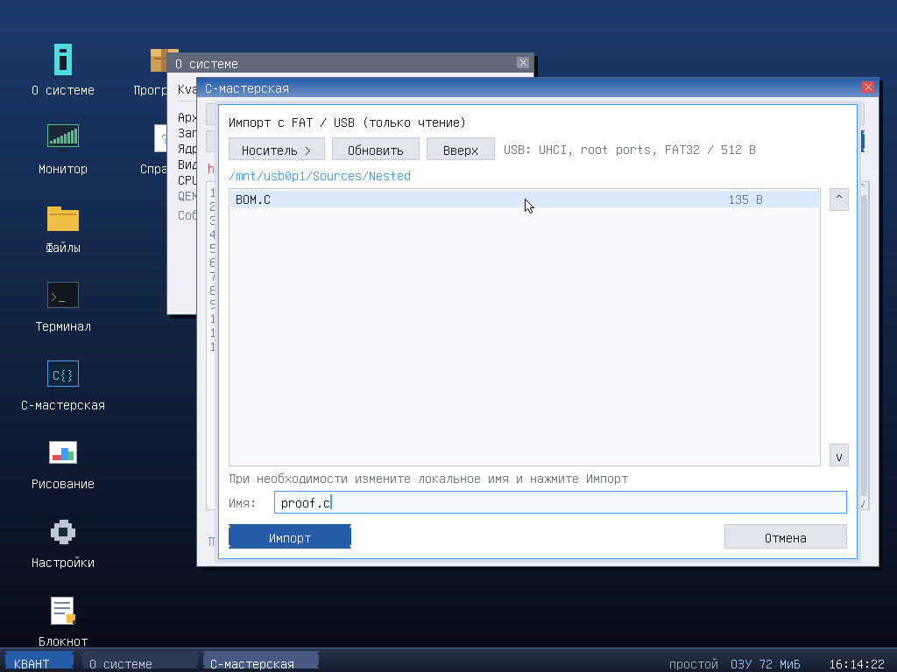

# Импорт с FAT32-флешки — сборка разработки после 3.1.2

Эта возможность добавлена в ветке `feature/fat32-import`. **В опубликованной
3.1.2 её нет**; для проверки нужна новая preview-сборка ISO, а не прежний релиз.
Существующие теги и опубликованные файлы 3.1.2 не изменялись.

## Как пользоваться

1. Скопируйте исходники `.c` или текстовые файлы на уже подготовленную
   **FAT32-флешку** обычными средствами другого компьютера. Создавать образ
   KvFS и устанавливать SDK для переноса больше не нужно.
2. Подключите флешку непосредственно к поддерживаемому USB-порту.
3. В **C-мастерской** или **Блокноте** нажмите **Импорт**. Если есть правки,
   сначала появится обычный диалог «Сохранить / Не сохранять / Отмена».
4. Нажмите **Обновить**, если подключили накопитель после загрузки ОС.
   **Носитель >** переключает найденные FAT-тома. Путь `/mnt/usb0p1`
   означает первый раздел USB-накопителя; `/mnt/usb0` — FAT без таблицы разделов.
5. Щёлкайте папки для входа, **Вверх** — для возврата. Выберите файл.
   В мастерской показаны папки и файлы `.c`/`.C`; Блокнот показывает все файлы,
   но импортирует только подходящий текст.
6. При необходимости измените **локальное имя** внизу. Длинное имя на FAT
   не переименовывается: для RAM/KvFS используется отдельное короткое имя.
   Нажмите **Импорт**. Совпадение локального имени требует подтверждения.
7. Копия появляется в RAM и открывается в редакторе. **Сохранить** записывает
   её на смонтированный KvFS, **Собрать / Запуск** собирает исходник обычным
   встроенным компилятором. Без KvFS копия и `.kapp` исчезнут после перезапуска.

**Импорт не записывает на источник.** USB-тома дополнительно защищены от
записи и в VFS, и в секторном маршрутизаторе: форматирование, удаление и
обратная запись на флешку этой реализацией не поддерживаются. Простое
подтверждение импорта также не перезаписывает существующий файл на KvFS:
это произойдёт только после «Сохранить» или успешной сборки с сохранением.

Накопитель виден и в обычном файловом менеджере: его существующая операция
копирования позволяет перенести другие типы файлов в поддерживаемое
локальное хранилище, в пределах ограничений файлового менеджера (до 4 МиБ).
Для исходников с длинными именами удобнее специальный диалог импорта.



## Важное ограничение USB

**Сейчас реализован только UHCI / USB 1.1, а не универсальный USB-стек.**
Поддерживаются full-speed устройства Mass Storage с Bulk-Only Transport,
SCSI transparent, LUN 0, логическим сектором 512 байт, подключённые к корневому
порту UHCI. До четырёх UHCI-контроллеров, по два корневых порта.

**EHCI, xHCI, OHCI, USB-хабы, UAS и диски с логическим сектором 4096 байт
пока не поддерживаются. На современном компьютере только с xHCI флешка
не появится.** Даже разъём USB 2.0 сам по себе не гарантирует наличие UHCI.
Наличие BIOS/UEFI-загрузки с USB тоже не означает, что ОС умеет читать этот
контроллер после загрузки: загрузчик и драйвер ОС — разные вещи.

Реальное оборудование не проверялось. На машинах с USB-клавиатурой/мышью
нужна отдельная проверка: передача UHCI от BIOS отключает его legacy SMI,
а собственного USB HID-драйвера здесь нет. PS/2 и существующие MouseKeys
сохраняются; NumLock включает управление указателем с NumPad.

FAT16/FAT32 распознаются на дисках с **MBR** (включая extended-разделы) и
на FAT без таблицы разделов. **GPT, exFAT и FAT12 не добавлены.** Диалог
показывает также FAT-тома на ATA, но USB проверяется отдельно настоящим
эмулируемым USB-контроллером, не подменяется IDE-диском.

Переподключение обнаруживается по **Обновить**, не автоматически в фоне.
При обновлении список начинается с корня первого FAT-тома. Старые списки в
обоих редакторах инвалидируются; их документы остаются на месте.

## Ограничения редактора

* До 128 строк, до 120 **байт**, а не символов, в строке; общий вход меньше
  15488 байт. Переполнение не приводит к тихому обрезанию.
* UTF-8, в том числе с BOM; CRLF превращается в LF, Tab — в четыре пробела.
  UTF-16 и двоичные файлы отклоняются. Пустой файл допустим.
* Локальное имя: ASCII-буквы, цифры, `.`, `_`, `-`, до 23 символов;
  для мастерской — до 18 символов основы и `.c`.
* В диалоге кэшируются до 128 подходящих элементов из первых 512 записей
  каталога. При переполнении списка выводится предупреждение: перенесите
  нужные исходники в отдельную папку. Путь — до 255 байт, имя VFS — до 127.
* При ошибке чтения, отключении устройства, недопустимом тексте, нехватке RAM
  или отмене прежний документ и его undo не заменяются.
* Список не перечитывается с флешки при каждом кадре. USB-секторный кэш
  сбрасывается при каждом повторном обнаружении устройства.

## Проверка в QEMU

Для примера предполагается существующий файл `flash.img` с FAT32.
**Это образ данных, а не файл ISO KvantOS.** Не подставляйте реальный диск
в команды подготовки тестовых образов, если не понимаете последствия.

```sh
make CC=gcc-12 iso
qemu-system-x86_64 -machine pc,accel=tcg -cpu pentium -m 256 \
  -cdrom release/kvantos.iso -boot d \
  -device piix3-usb-uhci,id=usbtest \
  -drive if=none,id=flash,format=raw,file=flash.img \
  -device usb-storage,bus=usbtest.0,drive=flash,port=1
```

Автотест создаёт только частные файлы в `build/`, без форматирования хоста:

```sh
# dosfstools, mtools, QEMU, OVMF, Pillow
python3 tests/boot/usb-import-smoke.py
# Секторная маршрутизация, защита от записи и 24 повторных монтирования
python3 tests/boot/mkusb.py build/usb-fixtures
make -C tests/fs
tests/fs/build/harness build/usb-fixtures/flash-raw.img --usb
tests/fs/build/harness build/usb-fixtures/flash-mbr.img --usb
```

Проверено в **реальных гостевых ядрах QEMU**, BIOS/i386 и UEFI/x86-64:
MBR и FAT без таблицы разделов; вход в папки; длинные имена; UTF-8 BOM,
кириллический текст, CRLF/Tab; переименование локальной копии; пустой файл;
отмена/подтверждение замены; отказ для binary/UTF-16/переполнений; 12 обновлений
подряд; отключение и повторное подключение; импорт → нативная сборка/запуск;
запись на KvFS и повторный запуск после полной перезагрузки без флешки;
работа без ATA, русский интерфейс, 640×480. **SHA-256 обоих исходных FAT32
образов до и после теста совпадает**, хотя QEMU разрешает запись на них.
Это не испытание произвольной физической флешки на реальном компьютере.
