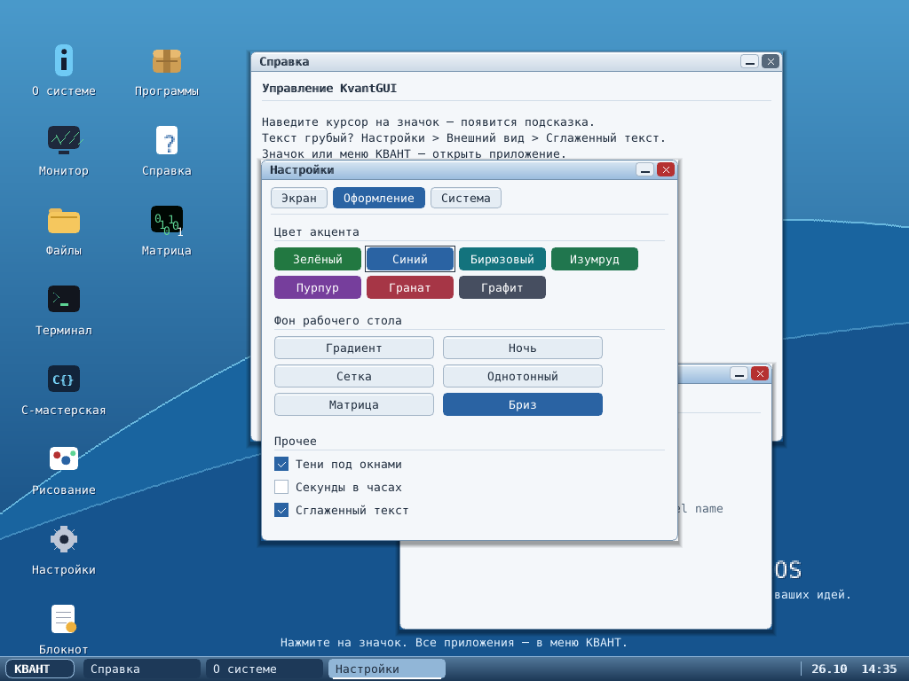

# «Бриз» — светлый KvantGUI

Обновление интерфейса рабочей ветки, **не новый опубликованный релиз**.
За основу взят Windows 7: светлые рабочие поверхности, голубые заголовки с
мягким градиентом, скругления, тени и спокойная панель задач. Это собственная
отрисовка на C, без веб-оболочки, внешних картинок и новых зависимостей ОС.
Эффект стекла стилизованный: размытия и настоящей прозрачности нет.

*Превью получено host-тестом из настоящих функций GUI, фреймбуфера и шрифтов.
Информация об оборудовании и время в этом тесте фиксированные; это не снимок
загруженной виртуальной машины.*

## Что изменилось

- Светлые окна, белые поля, тёмный текст, спокойное голубое выделение.
- Кнопки сворачивания и закрытия в заголовке. Свёрнутое окно можно вернуть
  кнопкой на панели задач; документ при сворачивании не закрывается.
- Панель задач автоматически уменьшает кнопки: доступны все восемь окон,
  в том числе в 640×480. Справа только дата и часы; сведения о памяти
  остаются в «Мониторе». Секунды можно включить в настройках.
- Новые векторные обои «Бриз», компактная подпись вместо большого центрального
  логотипа, контрастные подписи значков и подсказки.
- Общая светлая палитра для файлового менеджера, редакторов, поиска, импорта
  и справки C-мастерской. Терминал и Matrix намеренно остаются тёмными.
- Семь акцентов; более компактная вкладка «Оформление», чтобы все переключатели
  помещались в окно. Русский и английский интерфейсы сохранены.

## Исправления геометрии

- Углы кнопок и окон используют зеркальную маску сглаживания; градиент
  заголовка не рисует за пределами рамки. Исправлено смещение концов линий,
  из которых составлен крестик закрытия.
- Надписи кнопок выровнены по центру. Длинные названия сокращаются с учётом
  UTF-8 и доступной ширины; заголовок не залезает на кнопки окна.
- Между названием и описанием в меню оставлен отдельный отступ.
  Подсказки не выходят за край экрана.
- «О системе» переносит длинные строки в штатном окне 420×300 и показывает
  архитектуру/загрузчик своей сборки. «Справка» получила перенос строк и
  страницы с кнопками «Назад» / «Далее» в штатном окне 600×440.
- В «Рисовании» надпись «Цвет» больше не перекрывается образцами палитры.

## Настройки и совместимость

На чистой системе по умолчанию выбран синий акцент и «Бриз».
При наличии `settings.cfg` выбор пользователя сохраняется: для перехода с
Matrix откройте **КВАНТ → Настройки → Оформление → Бриз**.

Новые обои добавлены под индексом `5`; старые индексы `0…4` не переставлялись.
Matrix остаётся и приложением, и вариантом обоев. Индексы акцентов также
сохранены, но оттенки скорректированы для читаемости белых надписей; прежний
Neon теперь называется Green / «Зелёный».

ABI приложений, файловые форматы и политика записи на диски не менялись.
Номер версии и исторические заметки релиза 3.3.0 не переписаны. Чтобы получить
новый интерфейс в ОС, нужно собрать образы из этой ветки: старые скачанные
ISO автоматически не обновляются.

## Проверки

- `make -C tests/gui check`: ASan/UBSan, обе локали, 84 сочетания
  акцента/обоев/разрешения, геометрия кнопок, панели и настроек; PNG-превью.
- `make -C tests/mcc editors input`: модель редактора и EN/RU-ввод.
- C-исходники обоих ядер и EFI-загрузчик скомпилированы локально.
- Полная линковка, ISO и загрузка BIOS/UEFI локально не проверены:
  в среде отсутствуют NASM, QEMU, GRUB/xorriso и OVMF.
  Host-отрисовка не заменяет загрузочные smoke-тесты.

[Подробности host-теста](../tests/gui/README.md) ·
[Загрузочные проверки](../tests/boot/README.md)
