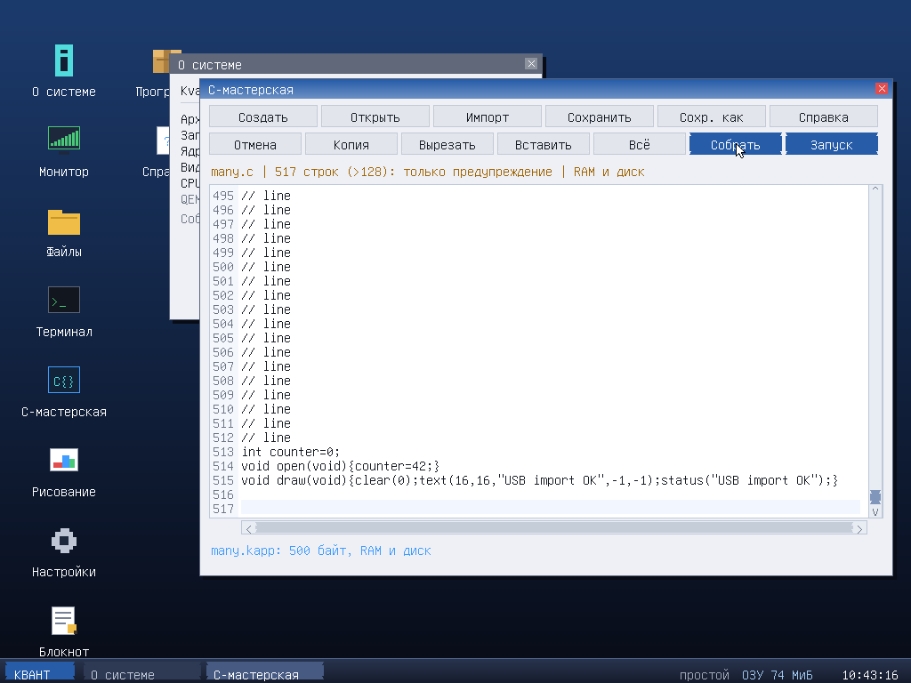
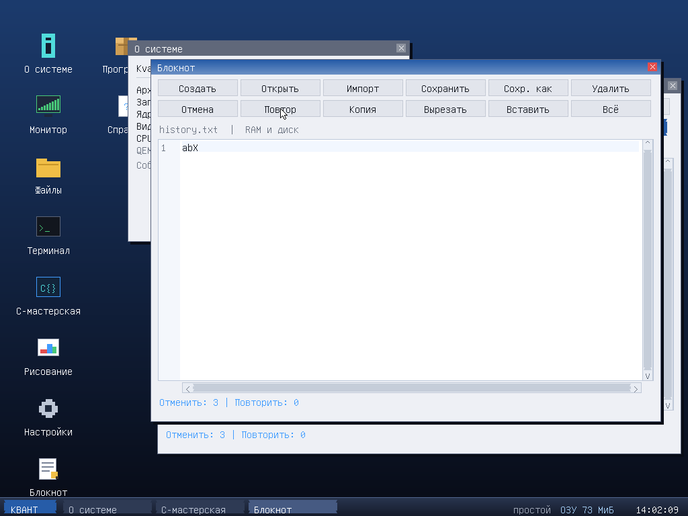

# In-system C Workshop

Open **C Workshop** by single-clicking its desktop icon or using **KVANT → C Workshop**. The built-in editor
and compiler produce native i386 or x86-64 `.kapp` files (format 1, ABI 3) inside KvantOS.
No host GCC, network, assembler or interpreter is involved in that build.
This is a small, explicitly limited C implementation, **not full ISO C**.

The target follows the running kernel: BIOS/i386 builds 32-bit apps, UEFI/x86-64
builds 64-bit apps. Pointers have native width; `int` remains 32-bit on both.
Move source files between architectures and rebuild them; generated binaries
are architecture-specific and cannot run under the other kernel.

## Use

* **Build** compiles and saves a native `.kapp`; **Run** rebuilds and starts it.
  A failed build never runs stale output. Errors show a line number and move the cursor.
* **Open** opens a RAM/disk picker: choose a file, then click Open. Use the wheel
  or arrow buttons to scroll the file list. No typed path or Enter is required.
* **Save** writes the current file, asking for a name for new documents.
  **Save as** changes the name. Replacing another existing file needs confirmation.
* **New**, open, close and desktop exit protect unsaved text with Save / Don't save /
  Cancel. **Help** has a clickable Close help button. Use window crosses to close,
  the taskbar/menu to switch, and KVANT → Exit to console to leave the desktop.
* Click text to place the caret; drag to select; dragging beyond an edge auto-scrolls.
  Copy / Cut / Paste / Undo / Redo / Select all are clickable. Clipboard is shared with
  Notepad; document state and histories are independent. Undo and Redo are
  separate buttons, also available as Ctrl+Z and Ctrl+Y. UTF-8 cursor/selection/
  deletion respects character boundaries. History keeps up to 64 edits within
  128 KiB of removed/inserted text per editor; large edits can evict old entries
  sooner. New edits discard redo. Returning to a saved revision via undo/redo
  restores the clean indicator; failed saves do not move that checkpoint.
* Both scrollbars are draggable; wheel scrolls vertically, Shift+wheel horizontally.
  Scrolling does not move or chase the caret.
* Keyboard remains for text and **optional** Ctrl+C/V/X/A/Z/Y/S, Ctrl+O/N/W, F5/F6,
  F1 help, F2 open. Arrows, Home/End, Delete, Backspace, Enter, Tab and Shift+arrows
  edit text. Ctrl+U clears a filename; Enter accepts, Esc cancels. Esc in the text
  only clears selection. Letters B/G/E no longer launch desktop windows; games
  retain their keyboard controls.

**128 lines is a warning only**, not a row-count ceiling. Import, editing,
undo/redo, Save and Build/Run keep working above it. The amber file header
shows the warning independently of save/build errors. Text is stored in a
packed byte pool: input and normalized text must be **less than 64 KiB**,
and each line remains limited to 120 **bytes**, not characters. Overflow,
binary loads and failed line joins never silently truncate/discard text.
The compiler's separate 16000-byte source limit does not block editing or
saving larger documents; Build explains that limit without changing text.

Use a flat filename with at most 18 characters before `.c`: `hello.c` becomes
`hello.kapp`. Without mounted **KvFS**, both files are in RAM and **lost on reboot**;
the status says so. With KvFS both are saved to RAM and disk. After reboot choose
**Open → Disk / KvFS**, select the source and click Open. The picker shows `.c`
files on the chosen medium; Program Manager shows `.kapp`. Direct save to FAT32/NTFS
or arbitrary VFS paths is not implemented. Notepad now also saves to mounted KvFS.

Disk persistence requires a supported **IDE/ATA PIO** disk, not AHCI/SATA
or NVMe. Under QEMU q35, attach a separate `piix3-ide` controller as shown
in RELEASE.md: q35 defaults `-drive if=ide` to SATA/AHCI, which this OS
does not detect.

## FAT32 USB source import (3.1.3)

Click **Import**, **Refresh USB**, choose a folder and `.c`/`.C` file,
optionally edit its local name, then **Import**. The validated copy opens in
RAM; Save/Build/Run work normally. The flash drive is not modified. UTF-8 BOM
and CRLF are supported; invalid/oversized text leaves the old document intact.
**UHCI + high-speed EHCI**, no OHCI/xHCI/hubs; included in 3.1.3, not in the older 3.1.2 ISO.
Read-only **GPT + FAT32** is supported; no conversion/reformatting required.
[Full instructions](../USB-IMPORT.md).

## Example

```c
int count = 0;
void draw(void) {
    clear(rgb(24, 32, 50));
    text(20, 20, "My C application", rgb(230, 240, 255), -1);
    fill(20 + count * 12, 90, 40, 40, rgb(60, 160, 240));
}
void click(int x, int y, int button) {
    count = (count + 1) % 20;
}
```

The compiler supplies `kapp_main`, the application descriptor, a 480x300
client area and the file header. The source filename becomes the window title.
Define `draw()` or `main()`; optional callbacks are `open()`, `key(int k)`,
`click(int x,int y,int button)`, `tick()` and `close()`. A zero-argument `main`
is used as `open` if there is no `open`. `close` runs on loader unload.

Call API functions directly, without a `sys->` prefix; no API `#include` is required.
Names and argument order match `kv_api_t` in `include/kvapp.h`:

* `width height rgb clear pixel fill rect line text text_width status`
* `alloc release mem_set mem_copy str_len str_cmp str_copy format`
* `ticks hz seconds delta_ms clock beep random log lang`
* `file_read file_write file_delete file_list file_exists` (KvFS)

For example `text(x,y,"UTF-8",foreground,-1)` uses a transparent background.
Use `alloc(64)` to obtain a string buffer for `format(buffer,64,"%d",value)`,
and `release(buffer)` to return it. `lang()` returns 0 for English, 1 for Russian.

## Language boundary

Supported: 32-bit signed `int`, signed `char`, `void`, pointers, globals with
literal/zero initialization, locals, named function parameters and prototypes,
helper functions and recursion, blocks, `if/else`, `while`, `for`, `return`,
`break`, `continue`, arithmetic/comparison/bitwise operators, short-circuit
`&& ||`, assignment and `+= -= *= /= %=`, prefix/postfix increments, address-of,
dereference, pointer indexing/arithmetic, strings/characters, comments and
basic escapes, fixed one-dimensional array declarations and `sizeof`. `const` is accepted but its write restrictions are not checked.

Not supported: full preprocessor, headers, unions/enums,
`static/extern`, unsigned/long types, floating point, variable-length/multidimensional arrays,
casts, `switch`, `do/while`, ternary/comma operators, function pointers,
external libraries, object files or full C type checking. Use `0` rather than
a `NULL` macro. Existing SDK examples with `sys->...` still require the
external GCC SDK; they do not compile unchanged in the workshop.

Limits: compiler source 16000 bytes; editor <64 KiB, 120 bytes/line,
warning only above 128 lines (no independent row limit); 24000-byte code and
8000-byte data sections; output fits 32 KiB. Up to 8 arguments, 256 symbols
(including API), 128 local records and 512 (i386) / 1024 (x86-64) bytes of local stack per function,
8 nested loops, 24 parser nesting levels and 511 bytes per string literal.

### Fixed arrays and sizeof (M5.1 development)

Use `int values[8];`, `char buffer[64];` or `int *slots[4];` globally or locally.
An extent must be a positive integer **literal** within the existing data/stack
budgets (no VLA, omitted extent or constant-expression extent yet). Global arrays
start zeroed; local arrays are uninitialized. Arrays decay to element pointers
for indexing, arithmetic and calls; declare parameters as `int *p`, not `int p[8]`.
No array initializers, multidimensional arrays or pointer-to-array/whole-array
address-of syntax yet; `&values[0]` works. Runtime indexes are **not bounds checked**.

`sizeof(int)`, `sizeof(char)`, `sizeof(int*)`, `sizeof values`, `sizeof(values[0])`
and expression/string operands are supported. `char` is 1 byte, `int` 4, pointer
4/8 by target; whole arrays report count × element size, excluding stack padding.
Operands are parsed/type-checked but never run, including calls and increments.
`sizeof(void)` is rejected. The subset returns sizes as **int**, not ISO C's
`size_t`; consequently `sizeof(sizeof(int))` is 4 even on x64. Global initializers
still accept literals only, and type-name array syntax such as `sizeof(int[8])`
is not supported. All pre-existing source/code/data/stack budgets stay unchanged.

```c
void draw(void) {
    char buffer[64];
    format(buffer, sizeof buffer, "%d", sizeof(int*));
    clear(0);
    text(10, 20, buffer, -1, -1);
}
```

## Safety and tests

Like other KvantOS applications, generated native code runs in **ring 0**,
not a sandbox. Invalid pointers, deep recursion and infinite loops can crash
or hang the OS. Save source first and experiment in QEMU with a disk copy.
Parser safety does not imply runtime program safety.

```sh
python3 -m pip install unicorn
make -C tests/mcc check           # 267 execution checks per target (i386 and x86-64)
make -C tests/mcc sanitize ramfs  # 40000 mutations per target, atomic RAM save
python3 tests/mcc/smoke.py        # guest builds/runs, error handling, reboot, diskless
```

The smoke test runs both BIOS/i386 and UEFI/x86-64 guests and only writes its
own `tests/mcc/build/{bios32,uefi64}/workshop.img` disks. It also checks native
locals, double pointers, heap allocations, eight-argument functions and
variadic API calls inside the OS. The 64-bit Unicorn tests place the stack
above 4 GiB and verify SysV alignment and callee-saved registers.
See [the Russian guide](WORKSHOP.ru.md) for the same workflow and examples.

### Warning instead of the 128-line ceiling (3.1.3)



Actual QEMU/UEFI capture: 512 comment lines plus a working application.
Checks cover GPT/FAT32 over EHCI, import/edit/undo/redo/build/run, KvFS save,
and reopen/run after reboot. Independent UTF-8 Notepad tests use 2049 and
10001 lines, including the five-digit gutter.

### 3.1.4 development: multi-step history



Development branch, not a new published release. Tests cover multiple steps,
independent editors, redo branching, saved-revision tracking and KvFS writes.
See [ROADMAP](../ROADMAP.md) for remaining phases and acceptance criteria.


### 3.1.4-dev: RU input, find/replace and storage state

The **EN/RU** chip or **Alt+Shift** selects Russian ЙЦУКЕН in both editors and
search fields (Caps/Shift, ё/Ё/№ included). UI language is independent. Filename
fields, shell commands and the application key ABI keep physical English input;
Ctrl shortcuts remain usable. **Find** / Ctrl+F opens literal, case-sensitive,
wrapping search; Ctrl+H focuses replacement. Previous/Next, Replace/Replace all
are clickable. Replace first selects a match if the selection does not match.
Each field permits 127 UTF-8 bytes: Tab changes field, Ctrl+U clears,
Enter/Shift+Enter searches forward/backward, Esc closes. Replace all is one Undo;
a line/text-budget failure preserves the document and history. No regex/case folding.

The permanent footer distinguishes Modified, RAM and KvFS for this document
revision, including no disk/write failures. After import, **Keep: KvFS** saves
only when clicked, never back to the source USB drive. No disk means temporary
RAM only. A failed disk write does not mark the document saved; a partial RAM
success is reported separately. This is not power-loss protection or monitoring
of every external overwrite.

### M5.2 development

Bounded object-like `#define` and builtin `#include` (M5.4 below) are supported; function macros,
conditionals, redefinition, continuation and #/## are still rejected.
Limits: 32 definitions, body 255 bytes, depth 8, expanded source 32000 bytes.
Original source limit remains 16000 bytes.

### M5.3 development

Bounded structs, member access, forward/self pointers and top-level typedef
aliases are supported. Native layout includes alignment/tail padding. No aggregate
copy, initializers or by-value function ABI, local/nested type definitions,
bitfields, unions or casts. Limits: 32 tags, 256 fields, 32 aliases.
See [type implementation boundary](../docs/M5.3-TYPES.ru.md).

## Experimental isolated target

The mouse ABI3/kernel ↔ ABI4/CPL3 switch selects the next build target. ABI3
remains the default trusted ring0 path. ABI4 uses private memory and a user-only
adapter, not kernel function pointers. Rect/text/line/status, bounded heap/string/
format/time helpers and private RAM file operations (including listing) work.
beep/log remain compile errors; readonly clock is available since M4.13. Files are 8 private RAM nodes×1024B, not
KvFS grants; Workshop's explicit source/binary saves remain separate.

Draw quotas: 64 operations and 1024 UTF-8 bytes per event; TEXT≤127B,
STATUS≤95B; LINE signed16 endpoints clipped to a≤4096² canvas; heap32KiB.
Drawing errors terminate only the user app. Draw in draw/open callbacks.
CODE24000/DATA8000/source16000 limits remain; isolated output49152 includes
its adapter. Legacy output32768 is unchanged. i386 non-PAE lacks hardware NX.
This is an experimental, not frozen ABI4 release. See docs/M4.10 through M4.12.


### M5.4: readonly virtual headers

Both targets accept literal `#include <kvui.h>` / `#include "kvui.h"`.
Only three immutable builtins exist: kvui.h includes kvkeys.h (8 KV_KEY_* plus
KV_CHAR_W/H) and kvtypes.h (kv_int=int, kv_byte=char, kv_point with int x,y).
kvui.h adds KV_BG=0x182032, KV_FG=0xe6f0ff, KV_TRANSPARENT=-1.
Each header is included once per compile. Combined cost: 13/32 macro slots,
3 aliases and 1 struct tag from the existing budgets. Not stdint/unsigned/libc.
No paths, escapes, macro filenames or disk/SDK header loading. Depth4 and
cycle/work/output guards preserve source error rows; source limit stays16000.
See [contract/proof](../docs/M5.4-VIRTUAL-HEADERS.ru.md).


### M4.13: readonly clock

`clock(&h,&m,&s)` now works in the isolated target; null/aliased outputs allowed.
Readonly cached kernel RTC snapshot (not a CMOS syscall, setter, date or timezone
API), h0..23/m,s0..59. New adapter requires caps127; invalid/unavailable results
fail-stop with exit35. Only beep/log remain unsupported in this profile.
[Contract and proof](../docs/M4.13-READONLY-CLOCK.ru.md).
